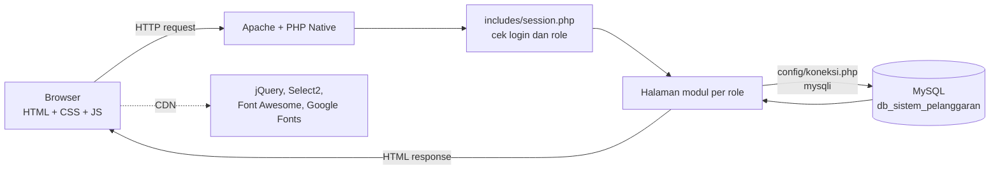
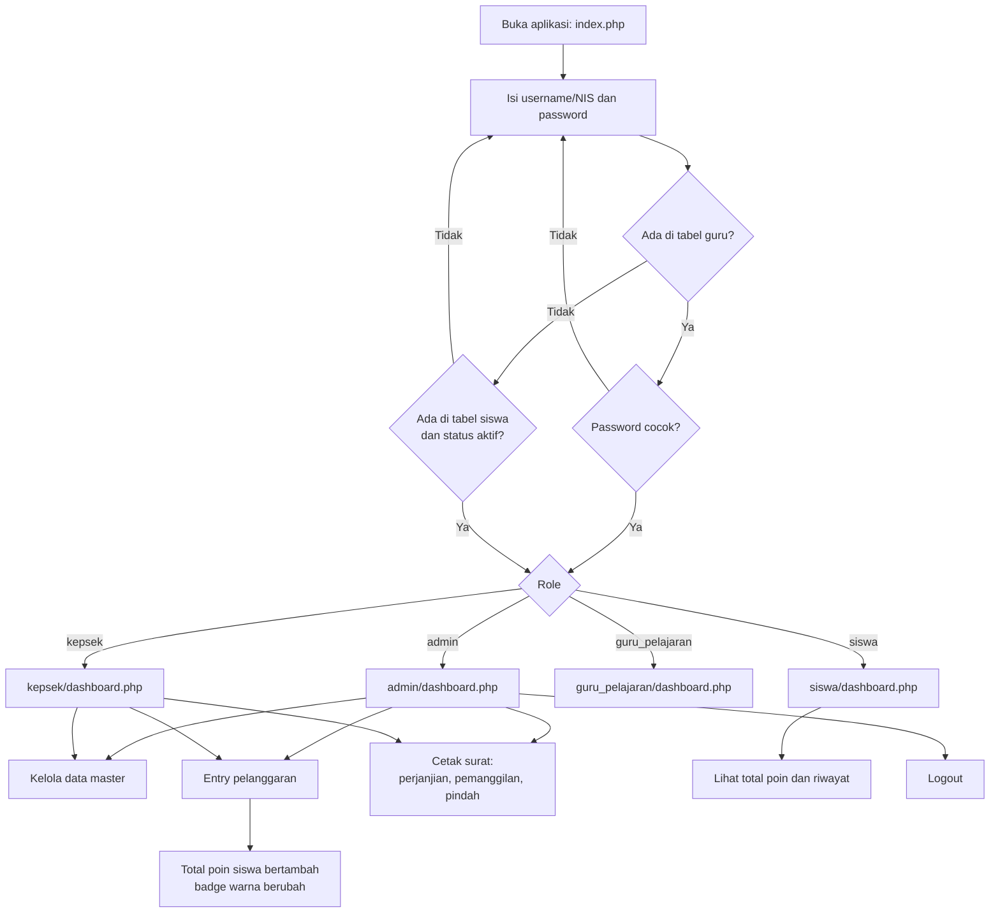
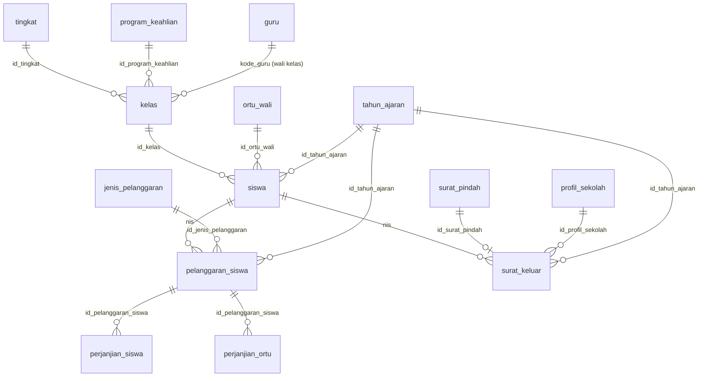

# Nama Tim dan Daftar Anggota
Nama Tim : Debuggers
1. Prayoga Aliffiant Farista Ananto
2. Letisia Victoria Pasaribu
3. Rakryan Teja Abhimata

# Video Demo : 

# Link Dokumentasi Website :

# Kategori (Website App) - SPPS (Sistem Poin Pelanggaran Siswa)

# 1. Pengenalan Projek
## Latar Belakang dan Masalah Utama
Banyak sekolah masih mencatat pelanggaran siswa secara manual di buku catatan atau lembar kertas. Cara ini punya beberapa kelemahan:
- Pencatatan tersebar dan rawan hilang. Setiap guru mencatat sendiri, sehingga riwayat satu siswa sulit dikumpulkan.
- Akumulasi poin dihitung manual. Guru BK harus menjumlahkan sendiri, sehingga ada risiko salah hitung dan siswa yang sudah melewati batas poin terlambat ditangani.
- Pembuatan surat memakan waktu. Surat pernyataan, pembinaan, panggilan orang tua, dan pindah sekolah harus diketik ulang dengan data siswa dan orang tua yang sama.
- Pengawasan sulit. Kepala sekolah dan wakil kepala sekolah tidak punya gambaran cepat tentang kondisi kedisiplinan.
- Siswa tidak tahu posisinya. Siswa baru mengetahui jumlah poinnya saat dipanggil.

## Gambaran Solusi

SPPS adalah aplikasi web yang memusatkan pencatatan pelanggaran siswa dalam satu database. Setiap pelanggaran yang dicatat langsung menambah poin siswa secara otomatis, status poin ditampilkan dengan badge warna, dan surat perjanjian maupun surat pemanggilan orang tua dapat dicetak langsung dari data yang sudah tersimpan, tanpa mengetik ulang. Setiap pengguna melihat dashboard sesuai perannya.

Dibangun dengan PHP Native, MySQL, HTML5, Vanilla JavaScript, dan Vanilla CSS tanpa framework eksternal.

## Target Pengguna
| Pengguna | Login dengan | Kegunaan utama |
|---|---|---|
| Admin | username | Mengelola data master (siswa, guru, kelas, jenis pelanggaran), mencatat pelanggaran, mencetak surat |
| Kepala sekolah / wakil | username	| Memantau kondisi kedisiplinan lewat dashboard ringkasan |
| Guru pelajaran | username | Mencatat pelanggaran siswa dan melihat ringkasan |
| Siswa | NIS | Melihat riwayat pelanggaran dan total poin sendiri |

## Fitur
- Login satu pintu untuk admin, kepsek, guru pelajaran (username) dan siswa (NIS)
- Pembatasan halaman berdasarkan role
- Data master: siswa, guru, kelas, jenis pelanggaran
- Entry pelanggaran dengan akumulasi poin per siswa dan badge warna berdasarkan total poin
- Cetak surat perjanjian dan surat pemanggilan orang tua
- Dashboard ringkasan per role

> Status: dalam pengembangan. Halaman Laporan dan Tahun Ajaran belum selesai.

# 2. Technical Documentation
## Arsitektur Sistem
Aplikasi berjalan dengan arsitektur web server-side sederhana tanpa framework:

## Diagram Alur Program

## Alur Hak Akses
Setiap halaman memanggil requireRole() dari includes/session.php. Jika role tidak sesuai, pengguna dialihkan ke dashboard role-nya sendiri.

| Role	| Dashboard	| Modul admin/* |
|---|---|---|
| admin | admin/dashboard.php | Boleh | 
| kepsek | kepsek/dashboard.php	| Boleh |
| guru_pelajaran | guru_pelajaran/dashboard.php	| Tidak |
| siswa	| siswa/dashboard.php | Tidak |

## Struktur folder
| Folder | Isi |
|---|---|
| `admin/` | Modul admin/kepsek: siswa, guru, kelas, jenis pelanggaran, pelanggaran, perjanjian, surat pemanggilan |
| `guru_pelajaran/`, `kepsek/`, `siswa/` | Dashboard per role |
| `includes/` | Session, pengecekan role, sidebar |
| `config/` | Koneksi database |
| `database/` | Skema dan data awal (tanpa data pribadi) |
| `docs/` | ERD dan catatan pengembangan |

# 3. Fronted Documentation
- Framework: tidak memakai framework. Halaman dirender di sisi server oleh PHP dengan HTML5, CSS murni, dan Vanilla JavaScript yang ditulis langsung di tiap halaman.
- Library lewat CDN: jQuery 3.6.0 dan Select2 4.1.0 (dropdown dengan pencarian di form pelanggaran, surat, dan siswa), Font Awesome 6.4.0 (ikon), serta font Inter dari Google Fonts. Karena memakai CDN, komputer perlu terhubung ke internet agar tampilan dan dropdown berfungsi normal.
- Struktur komponen UI: semua halaman setelah login memakai kerangka yang sama (app-wrapper berisi sidebar, topbar, dan page-content).

| Komponen | Lokasi	| Fungsi |
|---|---|---|
| Sidebar navigasi | includes/ | Menu menyesuaikan role pengguna |
| Dashboard ringkasan | admin/, guru_pelajaran/, kepsek/, siswa/ | Ringkasan data per role |
| Tabel data dan form | modul di admin/	| CRUD siswa, guru, kelas, jenis pelanggaran |
| Badge poin | halaman pelanggaran | Warna berdasarkan total poin siswa |
| Template surat | modul perjanjian dan pemanggilan | Tampilan siap cetak |

- Aset:
css/style.css dan css/auth.css untuk gaya (tema navy blue minimalis)
assets/kop_surat.jpg untuk kop surat
uploads/siswa/ untuk foto siswa (folder harus bisa ditulis oleh Apache)

# 4. Backend Documentation
Aplikasi memakai PHP Native tanpa REST API terpisah. Setiap halaman PHP langsung memproses request dan membaca/menulis database.

## Daftar Halaman dan Endpoint
<!-- TODO: lengkapi sesuai file PHP di repo -->

| File | Method	| Fungsi | Role |
|---|---|---|---|
| index.php	| GET, POST	| Form login dan autentikasi (password_verify)	| Semua| 
| logout.php | GET	| Menghapus sesi lalu kembali ke login	|Semua|
| admin/dashboard.php	| GET	| Dashboard dan statistik admin	|admin
| kepsek/dashboard.php	| GET	| Dashboard kepsek | kepsek |
| guru_pelajaran/dashboard.php	| GET	| Dashboard guru pelajaran	| guru_pelajaran |
| siswa/dashboard.php	| GET	| Total poin dan riwayat pelanggaran siswa	| siswa |
| admin/siswa/index.php	|GET, POST |	Daftar siswa, detail, hapus |	admin, kepsek |
| admin/siswa/tambah.php, edit.php	|GET, POST	| Tambah dan ubah siswa (termasuk foto dan data wali) |	admin, kepsek |
| admin/siswa/hapus.php	|GET/POST |	Hapus siswa	| admin, kepsek |
| admin/guru/index.php, tambah.php, edit.php	|GET, POST	| CRUD guru	| admin, kepsek |
| admin/kelas/index.php, tambah.php, edit.php	|GET, POST	| CRUD kelas	| admin, kepsek |
| admin/jenis_pelanggaran/index.php, tambah.php, edit.php	|GET, POST	| CRUD jenis| pelanggaran dan bobot poin	| admin, kepsek |
| admin/pelanggaran/index.php, tambah.php, edit.php	|GET, POST	| Daftar dan entry pelanggaran siswa |	admin, kepsek |
| admin/perjanjian/index.php, cetak.php	|GET, POST|	Surat perjanjian (siswa dan orang tua) |	admin, kepsek |
| admin/surat_pemanggilan/index.php, cetak.php	|GET, POST	| Surat pemanggilan orang tua |	admin, kepsek |
| admin/surat_pindah/index.php, tambah.php, cetak.php	| GET, POST	| Surat pindah sekolah |	admin, kepsek |
| admin/perjanjian/get_siswa_data.php	| GET ?nis=|	Mengembalikan JSON data siswa dan wali untuk mengisi form otomatis	| admin, kepsek|
| admin/surat_pemanggilan/get_siswa_data.php	| GET ?nis=| Sama seperti di atas untuk surat pemanggilan	| admin, kepsek |

Database Schema

Database: db_sistem_pelanggaran (MySQL, charset utf8mb4). Rincian kolom ada di database_schema.md.

| Tabel | Fungsi | Kolom utama |
|---|---|---|
| `guru` | Akun admin, kepsek, dan guru pelajaran | `kode_guru` (PK), `nama_pengguna`, `role`, `username`, `password` (hash), `aktif`, `jabatan`, `telp`, `foto` |
| `siswa` | Data dan akun siswa | `nis` (PK), `nama_siswa`, `jenis_kelamin`, `alamat`, `password` (hash), `status`, `id_ortu_wali`, `id_kelas`, `id_tahun_ajaran`, `foto` |
| `ortu_wali` | Data orang tua/wali | `id_ortu_wali` (PK), `nama`, `status_hubungan`, `pekerjaan`, `no_telp`, `alamat` |
| `kelas` | Data kelas | `id_kelas` (PK), `id_tingkat`, `id_program_keahlian`, `rombel`, `kode_guru` |
| `tingkat` | Tingkat kelas | `id_tingkat` (PK), `tingkat` |
| `program_keahlian` | Jurusan | `id_program_keahlian` (PK), `program_keahlian`, `deskripsi` |
| `jenis_pelanggaran` | Jenis pelanggaran dan bobot poin | `id_jenis_pelanggaran` (PK), `jenis`, `poin` |
| `pelanggaran_siswa` | Catatan pelanggaran | `id_pelanggaran_siswa` (PK), `tanggal`, `nis`, `id_jenis_pelanggaran`, `id_tahun_ajaran`, `keterangan` |
| `perjanjian_siswa`, `perjanjian_ortu` | Surat perjanjian | `id_pelanggaran_siswa`, `tanggal`, `status`, `foto_dokumen`, `tingkat` |
| `surat_pindah` | Detail surat pindah | `id_surat_pindah` (PK), `sekolah_tujuan`, `alasan_pindah` |

Nilai kolom guru.role yang dipakai aplikasi: admin, kepsek, guru_pelajaran.

## Konfigurasi Environment

Koneksi database saat ini dibaca dari config/koneksi.php. File .env.example berisi nilai konfigurasi yang dipakai sebagai acuan:

env
DB_HOST=localhost
DB_USER=root
DB_PASS=
DB_NAME=db_sistem_pelanggaran

Sesuaikan nilai yang sama di config/koneksi.php jika komputermu memakai kredensial MySQL yang berbeda dari default XAMPP.

# 5. Petunjuk Localhost
## Prasyarat
- XAMPP dengan Apache dan MySQL/MariaDB (PHP 7.4 atau lebih baru; sesuaikan dengan versi yang kalian pakai)
- Browser modern (Chrome, Edge, atau Firefox)
- Koneksi internet (untuk CDN jQuery, Select2, Font Awesome, dan Google Fonts)
- Dependencies: tidak ada yang perlu diinstal. Proyek ini tidak memakai Composer maupun npm.

## Langkah Instalasi
1. Salin folder proyek ke C:/xampp/htdocs/ dan beri nama folder sistem_pelanggaran. Nama ini ditulis tetap di includes/session.php, fungsi getBaseUrl().
2. Jalankan Apache dan MySQL dari XAMPP Control Panel, lalu buka phpMyAdmin (http://localhost/phpmyadmin).
3. Buat database db_sistem_pelanggaran (collation utf8mb4_unicode_ci), lalu import file skema database proyek ke database tersebut.
4. Jika kredensial MySQL berbeda dari default XAMPP (root, tanpa password), ubah di config/koneksi.php.
5. Pastikan folder uploads/siswa/ ada dan bisa ditulis (untuk foto siswa).
6. Buat akun admin pertama. Hasilkan hash password:
   php -r "echo password_hash('GantiPasswordIni', PASSWORD_DEFAULT);"
   lalu jalankan di tab SQL phpMyAdmin:
   INSERT INTO guru (kode_guru, nama_pengguna, role, username, password, aktif, jabatan)
   VALUES ('ADM00001', 'Administrator', 'admin', 'admin', 'HASH_DARI_LANGKAH_6', 'Y', 'Administrator Sistem');
7. Buka http://localhost/sistem_pelanggaran/ dan login dengan username admin dan password yang kamu buat di langkah 6.

## Mencoba Tiap Role
- Admin / kepsek: buat lewat tabel guru dengan role = admin atau kepsek, atau tambahkan guru lewat menu Guru setelah login sebagai admin.
- Guru pelajaran: role = guru_pelajaran.
- Siswa: tambahkan siswa lewat menu Siswa, lalu login memakai NIS dan password yang diisi saat menambah siswa. Akun siswa hanya bisa login jika statusnya aktif.

## Catatan keamanan
Data siswa, foto, dan akun asli tidak disertakan dalam repositori ini. Jangan commit file `.sql` berisi data asli atau password database.
