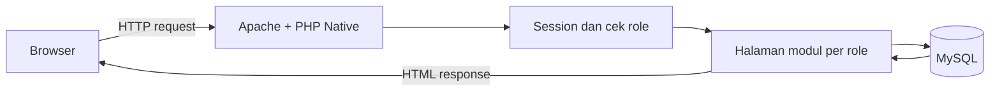
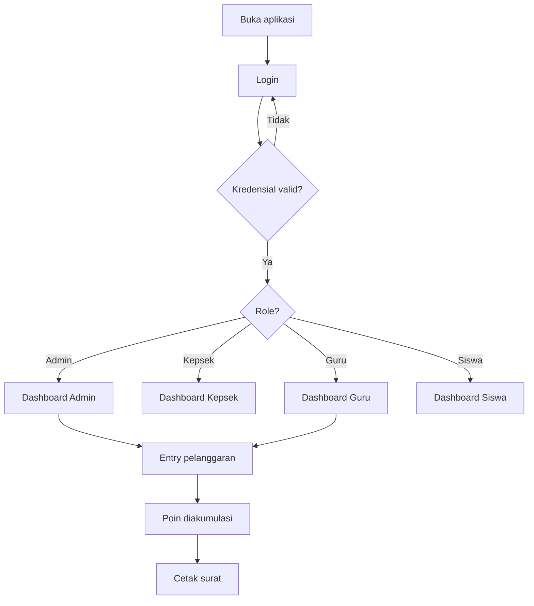

# Nama Tim dan Daftar Anggota
Nama Tim : Debuggers
1. Prayoga Aliffiant Farista Ananto
2. Letisia Victoria Pasaribu
3. Rakryan Teja Abhimata

# Kategori (Website App) - SPPS (Sistem Poin Pelanggaran Siswa)

# 1. Pengenalan Projek
## Latar Belakang dan Masalah Utama
Banyak sekolah masih mencatat pelanggaran siswa secara manual di buku catatan atau lembar kertas. Cara ini punya beberapa kelemahan:
- Pencatatan tersebar dan rawan hilang. Setiap guru mencatat sendiri, sehingga riwayat satu siswa sulit dikumpulkan.
- Akumulasi poin dihitung manual. Guru BK harus menjumlahkan sendiri, sehingga ada risiko salah hitung dan siswa yang sudah melewati batas poin terlambat ditangani.
- Pembuatan surat memakan waktu. Surat pernyataan, pembinaan, panggilan orang tua, dan pindah sekolah harus diketik ulang dengan data siswa dan orang tua yang sama.
- Pengawasan sulit. Kepala sekolah dan wakil kepala sekolah tidak punya gambaran cepat tentang kondisi kedisiplinan.
- Siswa tidak tahu posisinya. Siswa baru mengetahui jumlah poinnya saat dipanggil.

## Gambaran Solusi

SPPS adalah aplikasi web yang memusatkan pencatatan pelanggaran siswa dalam satu database. Setiap pelanggaran yang dicatat langsung menambah poin siswa secara otomatis, status poin ditampilkan dengan badge warna, dan surat perjanjian maupun surat pemanggilan orang tua dapat dicetak langsung dari data yang sudah tersimpan, tanpa mengetik ulang. Setiap pengguna melihat dashboard sesuai perannya.

Dibangun dengan PHP Native, MySQL, HTML5, Vanilla JavaScript, dan Vanilla CSS tanpa framework eksternal.

## Target Pengguna
| Pengguna | Login dengan | Kegunaan utama |
|---|---|---|
| Admin | username | Mengelola data master (siswa, guru, kelas, jenis pelanggaran), mencatat pelanggaran, mencetak surat |
| Kepala sekolah / wakil | username	| Memantau kondisi kedisiplinan lewat dashboard ringkasan |
| Guru pelajaran | username | Mencatat pelanggaran siswa dan melihat ringkasan |
| Siswa | NIS | Melihat riwayat pelanggaran dan total poin sendiri |

## Fitur
- Login satu pintu untuk admin, kepsek, guru pelajaran (username) dan siswa (NIS)
- Pembatasan halaman berdasarkan role
- Data master: siswa, guru, kelas, jenis pelanggaran
- Entry pelanggaran dengan akumulasi poin per siswa dan badge warna berdasarkan total poin
- Cetak surat perjanjian dan surat pemanggilan orang tua
- Dashboard ringkasan per role

> Status: dalam pengembangan. Halaman Laporan dan Tahun Ajaran belum selesai.

# 2. Technical Documentation
## Arsitektur Sistem
Aplikasi berjalan dengan arsitektur web server-side sederhana tanpa framework:



## Diagram Alur Program



## Instalasi (XAMPP)
1. Salin folder proyek ke `C:/xampp/htdocs/` dan **beri nama folder `sistem_pelanggaran`** (nama ini dipakai di `includes/session.php`, fungsi `getBaseUrl()`).
2. Jalankan Apache dan MySQL, buka phpMyAdmin.
3. Import `database/sipoin_schema.sql`, lalu `database/sipoin_seed.sql`.
4. Sesuaikan kredensial database di `config/koneksi.php` jika berbeda dari default XAMPP.
5. Buat akun admin pertama. Hasilkan hash password:
   ```bash
   php -r "echo password_hash('GantiPasswordIni', PASSWORD_DEFAULT);"
   ```
   lalu jalankan di phpMyAdmin:
   ```sql
   INSERT INTO guru (kode_guru, nama_pengguna, role, username, password, aktif, jabatan)
   VALUES ('ADM00001', 'Administrator', 'admin', 'admin', 'HASH_DARI_LANGKAH_5', 'Y', 'Administrator Sistem');
   ```
6. Buka `http://localhost/sistem_pelanggaran/` dan login.

## Struktur folder
| Folder | Isi |
|---|---|
| `admin/` | Modul admin/kepsek: siswa, guru, kelas, jenis pelanggaran, pelanggaran, perjanjian, surat pemanggilan |
| `guru_pelajaran/`, `kepsek/`, `siswa/` | Dashboard per role |
| `includes/` | Session, pengecekan role, sidebar |
| `config/` | Koneksi database |
| `database/` | Skema dan data awal (tanpa data pribadi) |
| `docs/` | ERD dan catatan pengembangan |

# 3. Fronted Documentation
- Framework: tidak memakai framework. HTML5, Vanilla JavaScript, dan Vanilla CSS, dengan halaman dirender di sisi server oleh PHP.
- Struktur komponen UI: halaman per role berbagi komponen yang sama dan dipanggil dengan include.
| Komponen | Lokasi	| Fungsi |
|---|---|---|
| Sidebar navigasi | includes/ | Menu menyesuaikan role pengguna |
| Dashboard ringkasan | admin/, guru_pelajaran/, kepsek/, siswa/ | Ringkasan data per role |
| Tabel data dan form | modul di admin/	| CRUD siswa, guru, kelas, jenis pelanggaran |
| Badge poin | halaman pelanggaran | Warna berdasarkan total poin siswa |
| Template surat | modul perjanjian dan pemanggilan | Tampilan siap cetak |

## Catatan keamanan
Data siswa, foto, dan akun asli tidak disertakan dalam repositori ini. Jangan commit file `.sql` berisi data asli atau password database.
